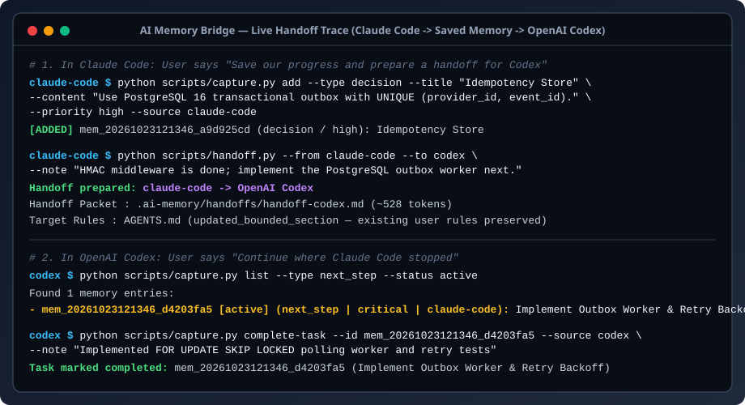

<div align="center">

# 🌉 AI Memory Bridge (`ai-memory-bridge`)

### **One Memory. Every AI Agent.**

**Local-first memory synchronization and seamless context handoff for AI coding agents.**

[](./LICENSE)
[](./skills/ai-memory-bridge/SKILL.md)
[](./pyproject.toml)
[-success.svg)](./pyproject.toml)
[](./docs/ci-workflow.yml)

**Works with:** Claude Code · OpenAI Codex · Cursor · Google Antigravity · Gemini CLI · OpenCode · GitHub Copilot

[Quick Start](#-quick-start) · [Installation](#-installation) · [How It Works](#-how-it-works) · [Supported Agents](#-supported-agents) · [Examples](#-real-reproducible-examples) · [Security](#-security)

🌐 **Languages:** **English** · [Русский](./docs/i18n/README.ru.md) · [Українська](./docs/i18n/README.uk.md) · [简体中文](./docs/i18n/README.zh-CN.md) · [Español](./docs/i18n/README.es.md)

</div>

---

## Why AI Memory Bridge?

Developers rarely use a single AI tool for an entire project. You might design architecture in **Claude Code**, delegate background implementation to **OpenAI Codex**, polish UI components in **Cursor**, and orchestrate multi-agent verification in **Google Antigravity**.

Every time you switch agents, **context evaporates**:
- Architectural decisions and *why* alternatives were rejected get lost.
- Technical constraints have to be re-explained from scratch.
- Static rule syncers overwrite your custom `CLAUDE.md` or `.cursor/rules/` files.
- Prose-only "Memory Bank" prompts drift, duplicate entries, or accidentally record secrets.

**AI Memory Bridge** solves this as a native **Agent Skill (`SKILL.md`)** backed by a deterministic, zero-dependency Python engine. Just tell your agent *"Save our progress"* or *"Prepare a handoff for Codex"*—the agent runs verified local scripts that validate schema, scan for secrets, deduplicate entries, detect architectural conflicts, and generate a ready-to-resume handoff packet.

---

## 🎬 Live Handoff Demonstration (`Claude Code -> Saved Memory -> Codex`)

<div align="center">
  
</div>

> Want to run or record this exact session in your terminal? Run `python examples/01-claude-to-codex/run_example.py` or see the [Demo Recording Guide](./docs/demo-recording-guide.md).

---

## ⚡ Quick Start

### 1. Install the Skill in One Command

```bash
npx skills add greenyarik0505-jpg/ai-memory-bridge
```

### 2. Talk to Your AI Agent Naturally (No Manual CLI Needed)

Once installed, you never need to memorize CLI flags. Just talk to your agent:

- **"Remember this project."** → Initializes `.ai-memory/`, adds `.ai-memory/` to `.gitignore`, and captures core goals, stack decisions, and constraints.
- **"Save our progress."** → Extracts completed tasks, pending work, bug fixes, and next steps, scans for secrets, deduplicates, and updates `.ai-memory/memory.json`.
- **"Prepare a handoff for Codex."** → Generates `.ai-memory/handoffs/handoff-codex.md` and non-destructively updates `AGENTS.md` inside bounded markers.
- **"Continue where Claude Code stopped."** → Reads the handoff packet and active tasks, checks for unresolved conflicts, and resumes work immediately.
- **"Sync project memory."** → Synchronizes active decisions, constraints, and tasks across all detected agents in your workspace.

---

## 📦 Installation

### Option A: Using Skills CLI (Recommended)

```bash
# Install into the current project (auto-detects your agents)
npx skills add greenyarik0505-jpg/ai-memory-bridge

# Target specific agents
npx skills add greenyarik0505-jpg/ai-memory-bridge --agent claude-code codex cursor

# Install globally for your user profile
npx skills add greenyarik0505-jpg/ai-memory-bridge -g

# Install from a local clone (offline)
npx skills add ./ai-memory-bridge --skill ai-memory-bridge
```

### Option B: Manual Installation (Zero Node.js Required)

Clone this repository and copy `skills/ai-memory-bridge` into your agent's skill directory:

```bash
git clone https://github.com/greenyarik0505-jpg/ai-memory-bridge.git

# Claude Code
mkdir -p .claude/skills && cp -R ai-memory-bridge/skills/ai-memory-bridge .claude/skills/

# OpenAI Codex
mkdir -p .codex/skills && cp -R ai-memory-bridge/skills/ai-memory-bridge .codex/skills/

# Cursor
mkdir -p .cursor/skills && cp -R ai-memory-bridge/skills/ai-memory-bridge .cursor/skills/

# Google Antigravity / Gemini CLI
mkdir -p .agents/skills && cp -R ai-memory-bridge/skills/ai-memory-bridge .agents/skills/
```

See the full [Installation Guide](./docs/installation.md) for Windows PowerShell commands and global paths.

---

## 🤖 Supported Agents

We test and verify every integration path. We distinguish between **Full**, **Supported**, and **Partial** integrations:

| AI Agent | Support Tier | Skill Discovery Path | Non-Destructive Rule Sync Target | Lifecycle Hooks (`SessionStart` / `Stop`) | Context Handoff Packet |
| :--- | :---: | :--- | :--- | :---: | :---: |
| **Claude Code** | **Full** | `.claude/skills/ai-memory-bridge/SKILL.md` | `CLAUDE.md` (bounded block) | ✅ Opt-in (`.claude/settings.json`) | `.ai-memory/handoffs/handoff-claude-code.md` |
| **OpenAI Codex** | **Full** | `.codex/skills/ai-memory-bridge/SKILL.md` | `AGENTS.md` (bounded block) | Conversational / Manual | `.ai-memory/handoffs/handoff-codex.md` |
| **Cursor** | **Full** | `.cursor/skills/ai-memory-bridge/SKILL.md` | `.cursor/rules/ai-memory-bridge.mdc` | Conversational / Manual | `.ai-memory/handoffs/handoff-cursor.md` |
| **Google Antigravity** | **Full** | `.agents/skills/ai-memory-bridge/SKILL.md` | `.agents/rules/ai-memory-bridge.md` | ✅ Opt-in (`.agents/hooks.json`) | `.ai-memory/handoffs/handoff-antigravity.md` |
| **Gemini CLI** | **Full** | `.agents/skills/ai-memory-bridge/SKILL.md` | `GEMINI.md` (bounded block) | Conversational / Manual | `.ai-memory/handoffs/handoff-gemini-cli.md` |
| **OpenCode** | **Supported** | `.opencode/skills/ai-memory-bridge/SKILL.md` | `AGENTS.md` (bounded block) | Conversational / Manual | `.ai-memory/handoffs/handoff-opencode.md` |
| **GitHub Copilot** | **Partial** | `.github/skills/ai-memory-bridge/SKILL.md` | `.github/instructions/ai-memory-bridge.instructions.md` | Not supported | `.ai-memory/handoffs/handoff-github-copilot.md` |

> **Why is GitHub Copilot marked Partial?** GitHub Copilot loads `.github/instructions/*.instructions.md` across IDEs and supports `.github/skills/` in VS Code Agent Mode, but standard inline completions and non-agent chat views cannot autonomously execute local Python scripts without VS Code Agent Mode terminal access.

---

## ⚙️ How It Works

Unlike prose-only prompt templates where LLMs manually edit Markdown files and frequently corrupt or overwrite history, **AI Memory Bridge** separates **agent judgment** from **deterministic execution**:

| Layer | Who | Responsibility | Scripts / Files |
| :--- | :--- | :--- | :--- |
| **1. Extraction & Intent** | **Your AI Agent** | Understands your conversational request, identifies architectural decisions, tasks, and constraints from the session, and calls the skill scripts. | [`SKILL.md`](./skills/ai-memory-bridge/SKILL.md) |
| **2. Verification & Storage** | **Python Engine** | Validates Schema `v1.0.0`, blocks secrets & prompt injections, deduplicates via SHA-256 + similarity, detects conflicts, and writes atomically. | [`memory_utils.py`](./skills/ai-memory-bridge/scripts/memory_utils.py), [`capture.py`](./skills/ai-memory-bridge/scripts/capture.py), [`init.py`](./skills/ai-memory-bridge/scripts/init.py) |
| **3. Sync & Handoff** | **Adapter Scripts** | Renders `context.md`, `decisions.md`, `tasks.md`, generates target handoff packets, and updates agent rules inside bounded markers. | [`handoff.py`](./skills/ai-memory-bridge/scripts/handoff.py), [`sync.py`](./skills/ai-memory-bridge/scripts/sync.py) |

---

## ✨ Features

### 1. Universal Project Memory (9 Structured Categories)
Stores and indexes every critical dimension of a software project inside `.ai-memory/memory.json`:
- `goal` — Core project objectives and scope.
- `decision` — Architectural and stack choices with supersede tracking.
- `task_done` — Completed tasks and milestones.
- `task_pending` — Active work in progress.
- `constraint` — Technical boundaries, runtime requirements, and forbidden patterns.
- `bug_fix` — Root causes of resolved bugs and how to prevent regressions.
- `preference` — Developer coding style and workflow preferences.
- `next_step` — Immediate next actions for the incoming agent.
- `session_summary` — Concise summaries of work sessions.

### 2. Smart Memory Engine
- **Automatic Deduplication**: Computes SHA-256 content hashes and normalized token similarity (`>= 0.90`). Duplicate entries update timestamps and boost priority instead of cluttering context.
- **Supersede Chains (`--supersedes`)**: Updating an outdated architectural decision marks the old record `superseded`, links `supersedes` / `superseded_by`, and preserves full history.
- **Automatic Conflict Detection**: Detects when two agents record competing technology choices (e.g., `PostgreSQL` vs `MongoDB`, `REST` vs `GraphQL`) or contradictory directives on the same topic without superseding, flagging both entries as `conflicted` until resolved.
- **Token-Budget Compaction**: Condenses older session summaries into a rolled-up digest and archives low-priority historical items while strictly preserving `critical` entries.
- **Versioned History & Rollback**: Every write appends an audit event to `.ai-memory/history/events.jsonl` and saves a revision snapshot (`rev_00001.json`, `rev_00002.json`, ...) that can be previewed and restored with `restore.py`.
- **1-Second Codebase Auto-Scanner (`scan.py`)**: Automatically inspects `package.json`, `pyproject.toml`, `Cargo.toml`, `go.mod`, `pubspec.yaml`, `Dockerfile`, and directory structure to populate initial stack decisions and build/test commands.
- **BM25 + File-Affinity Relevance Search (`capture.py search`)**: Retrieves the top-$K$ most relevant architectural decisions and past bug fixes for the exact file currently being edited (`--file src/payments/worker.py --query "retry"`).
- **Stale Memory & File Drift Detection (`check-stale` & `doctor.py`)**: Automatically detects when active memory entries reference project files that were later moved or deleted.
- **Git Branch & Commit Auto-Capture (`capture.py auto-git`)**: Extracts active branch, recent commit history, and modified working-tree files directly from Git, and prioritizes branch-specific tasks when switching branches.
- **Offline Interactive HTML Dashboard (`dashboard.py`)**: Generates a zero-dependency, XSS-safe visual explorer at `.ai-memory/dashboard.html` with live search, category/branch filters, conflict alerts, and audit history.

### 3. Seamless Cross-Agent Handoff
- Generates a self-contained handoff packet in `.ai-memory/handoffs/handoff-<agent>.md`.
- Updates `CLAUDE.md`, `AGENTS.md`, or `GEMINI.md` **only inside `<!-- AI-MEMORY-BRIDGE:START --> ... <!-- AI-MEMORY-BRIDGE:END -->` markers**—never overwriting your existing rules.
- Creates dedicated rule files for Cursor (`.cursor/rules/ai-memory-bridge.mdc`), Google Antigravity (`.agents/rules/ai-memory-bridge.md`), and GitHub Copilot (`.github/instructions/ai-memory-bridge.instructions.md`).

### 4. Opt-In Lifecycle Hooks
- Supports official `SessionStart` and `Stop` hooks for **Claude Code** (`.claude/settings.json`) and **Google Antigravity** (`.agents/hooks.json`).
- Disabled by default; enabled only when you explicitly request `--enable-hooks`.

---

## 🧪 Real Reproducible Examples

All 4 examples in [`examples/`](./examples/) use real commands, real input files, and self-verifying assertions in isolated temporary directories:

### Example 1: Claude Code to OpenAI Codex
Save an architectural decision (PostgreSQL transactional outbox) in Claude Code and generate a handoff packet + `AGENTS.md` sync for Codex:
```bash
python examples/01-claude-to-codex/run_example.py
```

### Example 2: Cursor to Google Antigravity
Capture technical constraints and pending tasks in Cursor, hand off to Google Antigravity, complete the pending task, and sync `.cursor/rules/ai-memory-bridge.mdc` and `.agents/rules/ai-memory-bridge.md`:
```bash
python examples/02-cursor-to-antigravity/run_example.py
```

### Example 3: Session Recovery & Version Rollback
Create a SHA-256 verified backup checkpoint, preview a rollback with `--dry-run`, and restore previous state with an automatic pre-restore safety backup:
```bash
python examples/03-session-recovery/run_example.py
```

### Example 4: Automatic Conflict Detection
Detect two contradictory architectural decisions (`PostgreSQL 16` from Claude Code vs `MongoDB` from Cursor) on the same topic and resolve the conflict cleanly:
```bash
python examples/04-conflict-detection/run_example.py
```

---

## 🗂️ Architecture & `.ai-memory/` Layout

When initialized in a project workspace, AI Memory Bridge maintains the following local directory structure (automatically added to `.gitignore`):

```text
.ai-memory/
├── memory.json          # Canonical structured store (Schema v1.0.0)
├── context.md           # Auto-rendered goals, constraints, preferences, bug fixes, and summaries
├── decisions.md         # Auto-rendered active, conflicted, and superseded architectural decisions
├── tasks.md             # Auto-rendered immediate next steps, pending tasks, and completed tasks
├── handoffs/            # Agent-specific handoff documents (handoff-codex.md, handoff-cursor.md, ...)
├── backups/             # SHA-256 verified snapshot bundles (backup_<timestamp>_rev<N>.json)
└── history/             # Append-only audit log (events.jsonl) + per-revision snapshots (rev_00001.json)
```

Every write uses atomic temporary file replacement (`tempfile.mkstemp` + `os.fsync` + `os.replace`) so interrupted processes never corrupt `memory.json`.

---

## 🔒 Security

AI Memory Bridge treats local project memory as a security-critical boundary:

- **100% Local-First**: Zero cloud servers, zero API keys, zero telemetry, and zero network calls.
- **Secret Scanning (`scan_for_secrets`)**: Automatically scans and blocks OpenAI, Anthropic, Google, AWS, and Stripe keys, GitHub/Slack tokens, PEM private keys, and database credential URIs before writing to disk (with optional `--redact-secrets` masking).
- **Prompt Injection Defense (`scan_for_prompt_injection`)**: Blocks instruction overrides (`ignore all previous instructions`), system role hijacks (`<|im_start|>system`), hidden shell execution comments (`<!-- EXEC:`), and marker breakout attempts.
- **Path Traversal & Symlink Protection (`safe_resolve_path`)**: Rejects `..` path traversal outside the workspace root, null bytes, and symbolic links anywhere in the target path chain.
- **Dry-Run Previews & Confirmation Gates**: Destructive operations (`restore.py`, `init.py --force`) support `--dry-run` and require explicit `--confirm` while creating an automatic pre-restore backup.

See [`SECURITY.md`](./SECURITY.md) and [`references/security.md`](./skills/ai-memory-bridge/references/security.md) for full details.

---

## ⚠️ Limitations

1. **No Access to Closed Vendor Cloud Memories**: AI Memory Bridge cannot read proprietary server-side chat logs or internal model weights. It synchronizes what is captured via the skill scripts, lifecycle hooks, or workspace markdown files.
2. **Lifecycle Hooks Depend on Host Agent Support**: Automatic `SessionStart` and `Stop` hooks are natively supported in **Claude Code** and **Google Antigravity**. Agents without local lifecycle hook configs (**Codex CLI**, **Cursor**, **Gemini CLI**, **OpenCode**) use conversational skill triggers (*"Save our progress"*, *"Prepare handoff"*).
3. **Rule Token Budgets**: While `.ai-memory/memory.json` can store hundreds of historical entries, agent rule files (`CLAUDE.md`, `AGENTS.md`, `.mdc`) should remain concise. Use `sync.py --compact --max-tokens 2000` on large long-running projects.

---

## ❓ FAQ

**Q: Will `sync.py` or `handoff.py` overwrite my existing `CLAUDE.md` or `AGENTS.md`?**
No. AI Memory Bridge only updates content inside `<!-- AI-MEMORY-BRIDGE:START --> ... <!-- AI-MEMORY-BRIDGE:END -->` markers at the bottom of the file. Everything outside those markers is untouched.

**Q: Should I commit `.ai-memory/` to Git?**
By default, `init.py` adds `.ai-memory/` to `.gitignore` so personal session history and local paths stay private on your machine. If your team wants to share `.ai-memory/context.md` or `decisions.md` in a private repository, you can selectively un-ignore those specific files.

**Q: Does this require Node.js or `pip install` to run?**
No. The skill runtime uses only the Python 3.10+ standard library. `npx skills add` is an optional one-command installer; you can also install via standard `git clone` and `cp`.

---

## 🤝 Contributing & License

Contributions, bug reports, and new agent adapters are welcome! Please read [`CONTRIBUTING.md`](./CONTRIBUTING.md) before submitting a pull request.

Released under the [MIT License](./LICENSE).
