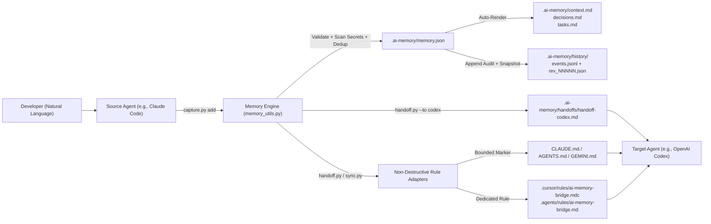

# AI Memory Bridge Architecture

## Design Philosophy

Modern AI-assisted development involves switching between multiple specialized coding agents:
- **Claude Code** for deep terminal-based refactoring and architecture exploration.
- **OpenAI Codex** for autonomous task execution and verification.
- **Cursor** for rapid interactive IDE edits.
- **Google Antigravity** for full-stack agentic workflows and subagent orchestration.
- **Gemini CLI**, **OpenCode**, and **GitHub Copilot** for lightweight CLI and editor assistance.

Without a shared, deterministic memory layer, every tool switch forces the developer to manually re-explain architectural decisions, constraints, and task status. Pure prose "Memory Bank" prompts fail because LLMs format files inconsistently, accidentally overwrite earlier decisions, and lack secret scanning or conflict detection.

**AI Memory Bridge** follows the same architectural principle proven by `geo-sleuth`:
**Deterministic logic belongs in executable scripts; extraction and synthesis belong to the agent.**

---

## Three-Layer Architecture

| Layer | Responsibility | Component |
| :--- | :--- | :--- |
| **1. Conversational Intent Layer** | Understands natural user prompts (*"Save our progress"*, *"Prepare a handoff for Codex"*), identifies relevant project facts, and invokes the skill scripts. | `SKILL.md` + Host AI Agent |
| **2. Deterministic Memory Engine** | Schema validation, secret detection, prompt-injection defense, SHA-256 deduplication, conflict detection, revision history, atomic writes, and token compaction. | `scripts/memory_utils.py`, `capture.py`, `init.py`, `backup.py`, `restore.py`, `doctor.py` |
| **3. Cross-Agent Adapter & Handoff Layer** | Renders human-readable Markdown views (`context.md`, `decisions.md`, `tasks.md`), generates target-specific handoff packets (`handoffs/handoff-<agent>.md`), and updates agent rule files non-destructively. | `scripts/handoff.py`, `scripts/sync.py` |

---

## Data Flow Diagram

---

## Key Architectural Guarantees

1. **Single Canonical Store**: `.ai-memory/memory.json` is the sole canonical state. All Markdown files (`context.md`, `decisions.md`, `tasks.md`, `handoffs/*.md`) and synced agent rule blocks are deterministically derived from `memory.json`.
2. **Atomic Persistence**: Every file write uses `tempfile.mkstemp` in the target directory followed by `os.fsync` and `os.replace`, preventing partial writes or corrupted JSON if a process is interrupted.
3. **Zero External Dependencies**: All scripts run on Python 3.10+ standard library only (`json`, `pathlib`, `hashlib`, `difflib`, `re`, `tempfile`, `argparse`). No `pip install` or `npm install` is required at runtime.
4. **Non-Destructive Coexistence**: Existing `CLAUDE.md`, `AGENTS.md`, and `GEMINI.md` files are updated strictly inside `<!-- AI-MEMORY-BRIDGE:START --> ... <!-- AI-MEMORY-BRIDGE:END -->` markers. Cursor, Antigravity, and GitHub Copilot receive dedicated namespaced files (`.cursor/rules/ai-memory-bridge.mdc`, `.agents/rules/ai-memory-bridge.md`, `.github/instructions/ai-memory-bridge.instructions.md`).
